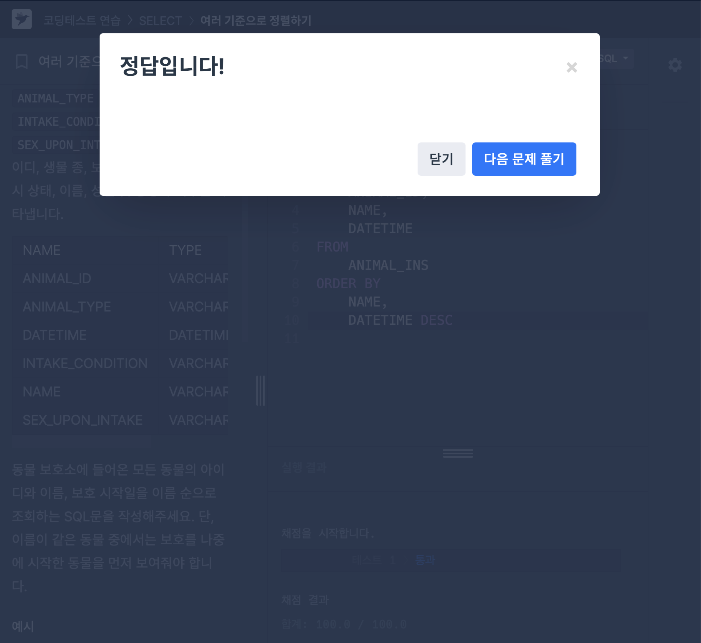
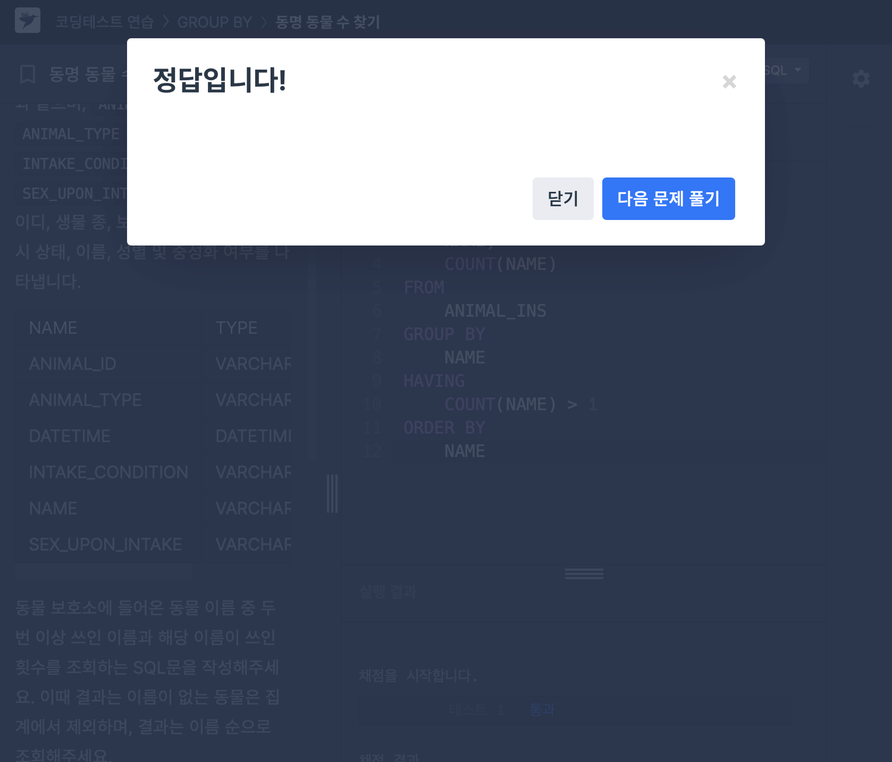

# 📘 SQL_BASIC 7주차 정규 과제

이번 주 필수 강의는 없습니다.

이번 주는 지금까지 배운 SQL 내용을 가볍게 복습하는 것으로 마무리합니다. 문제 풀이보다 중요한 것은 **내가 어떤 SQL 개념을 익혔고, 아직 어떤 부분이 헷갈리는지 정리하는 것**입니다.

완성된 과제는 Github에 업로드하고, 링크를 스프레드시트 'SQL' 시트에 입력해 제출해주세요.

**👀 수행 인증란은 필수입니다.**

---

## 📚 SQL_BASIC_7th_REVIEW

---

## ✨ 선택 강의

- 6-2. 가독성을 챙기기 위한 SQL 스타일 가이드: SQL을 더 읽기 좋게 작성하고 싶을 때 선택 수강
- 6-3. 가독성을 챙기기 위한 WITH 문 & 파티션: WITH 문과 파티션 개념을 가볍게 살펴보고 싶을 때 선택 수강
- 6-4. 데이터 결과 검증 정의: 쿼리 결과를 검증하는 관점을 알고 싶을 때 선택 수강
- 6-5. 데이터 결과 검증 예시: 결과 검증 사례를 확인하고 싶을 때 선택 수강

---

## 🏁 전체 강의 수강 계획

| 주차 | 필수 강의 범위 | 선택 강의 | 완료 여부 |
| --- | --- | --- | --- |
| 1주차 | 1-1 ~ 2-1 | 1 | ✅ |
| 2주차 | 2-2 ~ 2-3 | 2-4 | ✅ |
| 3주차 | 2-5, 2-7 ~ 2-8 | 2-6 | ✅ |
| 4주차 | 3-2 ~ 4-3 | 3-4 | ✅ |
| 5주차 | 4-4 ~ 4-6 | 4-5, 4-7 | ✅ |
| 6주차 | 5-2 ~ 5-5 | 5-6 | ✅ |
| 7주차 | 필수 강의 없음 | 6-2, 6-3, 6-4, 6-5 | ✅ |

---

<br>

<!-- 여기까진 그대로 둬 주세요-->

---

## 🔁 복습할 개념

- SELECT, FROM, WHERE
- ORDER BY, LIMIT
- GROUP BY, HAVING
- COUNT, SUM, AVG, MAX, MIN
- 문자열 함수
- 날짜/시간 함수
- CASE WHEN
- JOIN

---

# 1️⃣ 전체 개념 복습

아래 키워드 중 중요하다고 생각한 개념을 2개 이상 골라 짧게 정리해주세요. 3개보다 더 많이 정리하고 싶다면 자유롭게 항목을 추가해도 좋습니다.

복습 키워드:
- SELECT
- WHERE
- GROUP BY
- HAVING
- 문자열 함수
- 날짜/시간 함수
- CASE WHEN
- JOIN

## 01.

```
개념 이름: JOIN
개념 설명: 두 개 이상의 테이블에서 공통된 컬럼을 기준으로 데이터를 연결함. 여러 테이블에 나눠져 있는 정보를 결합하여 분석할 때 사용됨. 
예시 쿼리:
SELECT 컬럼A, 컬럼B
FROM 테이블A AS A
JOIN 테이블B AS B
ON A.컬럼1 = B.컬럼1
```

## 02.

```
개념 이름: SELECT
개념 설명: 테이블에서 조회하고 싶은 컬럼을 선택함. 필요한 데이터만 선택하여 확인하거나 여러 컬럼을 한 번에 조회할 수 있음. 
예시 쿼리:
SELECT 컬럼A, 컬럼B
FROM 테이블A
```

## (선택) 03.

```
개념 이름:
개념 설명: 
아직 헷갈리는 점: 
```

---

# 2️⃣ 수행 인증란

아래 중 하나 이상을 첨부해주세요.

- 복습 문제 정답 화면 캡처
- SQL 실행 결과 화면 캡처
- 전체 개념 정리 노트 캡처

---





# 3️⃣ 복습 문제

프로그래머스는 로그인이 필요하므로, 로그인 후 문제 풀이를 진행해주세요.

## 🧩 문제 1

문제 링크: [여러 기준으로 정렬하기](https://school.programmers.co.kr/learn/courses/30/lessons/59404)

풀이 과정:

```
- 문제 요구사항: (1)모든 동물의 아이디, 이름, 보호시작일 출력 / (2)이름 순으로 조회 / (3)이름이 같은 경우 보호 나중에 나중에 시작한 동물 먼저 
- 첫 번째 정렬 기준: 이름 순
- 두 번째 정렬 기준: 보호 시작일이 나중인 동물 먼저 (보호 시작일 내림차순)
- 복습한 점: 정렬 기준이 여러 개인 경우 어느 것을 먼저 작성하고 어느 것을 나중에 써야 하는지 복습할 수 있었다. 
```


## 🧩 문제 2

문제 링크: [동명 동물 수 찾기](https://school.programmers.co.kr/learn/courses/30/lessons/59041)

풀이 과정:

```
- 그룹화 기준: NAME
- 제외해야 하는 값: 이름이 없는 동물 
- HAVING 조건: 이름 횟수 두 번 이상. ->  COUNT(NAME) > 1
- 복습한 점: GROUP BY는 집계 함수(COUNT(), SUM() 등)과 주로 쓰인다는 것과 having은 그룹화된 결과에 조건이 적용되는 것을 복습할 수 있었다. 
```


---

# 4️⃣ 최종 회고

7주 동안 SQL BASIC 과제를 진행하며 느낀 점을 자유롭게 작성해주세요.

```
1. SQL을 배우기 전과 비교했을 때 달라진 점: 문제를 보는 눈이 달라진 것 같다. 문제를 보고 문제에서 요구하는 것을 찾는 것이 처음 시작할 때는 찾아내기 어려웠는데 여러 번 과제를 수행하다보니 문제에서 요구하는 것을 알아채는 법을 배울 수 있었다. 
2. 가장 도움이 되었던 과제 또는 문제 유형: JOIN을 활용해 여러 테이블의 데이터를 연결하는 문제가 가장 도움이 되었다. 여러 테이블에 분리된 데이터를 하나로 결합하여 분석에 활용할 수 있다는 점을 이해할 수 있었다. 
3. 가장 어려웠던 개념: HAVING과 WHERE에 쓰이는 조건문의 형태들을 이해하는 것이 어려웠다. 특히 LIKE, IN 등의 조건 연산자를 어떤 상황에서 활용해야 하고 조건에 따라 적절한 표현식을 작성하는 것이 가장 어려웠다. 
4. 앞으로 데이터 분석이나 프로젝트에서 SQL을 어떻게 활용해보고 싶은지: SQL이 대량의 데이터를 조회하고 관리하는 데 효율적이라고 알고 있기 때문에 프로젝트에서 필요한 데이터를 통합하고 전처리하는 과정에 SQL를 활용해보고 싶다. 
5. SQL BASIC 과제에 대한 피드백: 배운 개념들을 직접 쿼리로 작성해보고 실행해 볼 수 있어서 SQL의 개념들을 배우는 데에 도움이 되었다. 
```

정말 수고하셨습니다!
